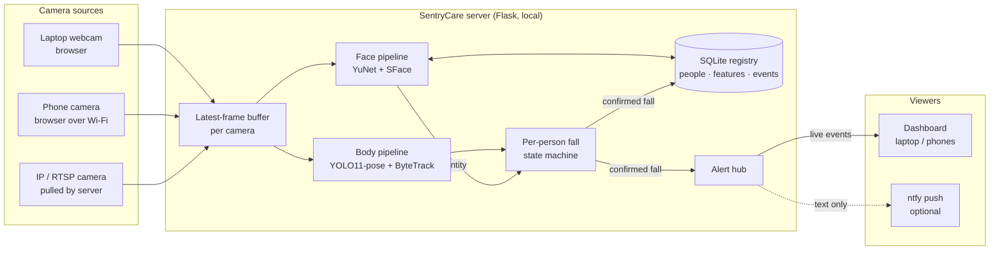

# SentryCare

**Camera-based resident safety monitoring for aged-care environments.**

SentryCare turns ordinary cameras (a laptop webcam, a phone, or an IP/CCTV camera) into a resident-safety monitor.
It recognises enrolled people, tracks every person in view, detects falls, and alerts caretakers in real time.
All processing runs locally on a standard laptop CPU. No cloud service is required, and biometric data never leaves the machine.

> **Academic research prototype.** SentryCare has not been clinically validated and is not a certified safety
> device. Fall alerts are intended to prompt a human check, not to replace supervision.

---

## Contents

- [Key features](#key-features)
- [How it works](#how-it-works)
- [Technology stack](#technology-stack)
- [Getting started](#getting-started)
- [Using SentryCare](#using-sentrycare)
- [Evaluation](#evaluation)
- [Experiment notebooks](#experiment-notebooks)
- [Report, slides and demo](#report-slides-and-demo)
- [Testing](#testing)
- [Project structure](#project-structure)
- [Configuration](#configuration)
- [Privacy and data handling](#privacy-and-data-handling)
- [Limitations and future work](#limitations-and-future-work)
- [Acknowledgements and licences](#acknowledgements-and-licences)
- [Team](#team)

---

## Key features

| Area | Capability |
|---|---|
| **Face recognition** | Enrol people from guided multi-angle captures or uploaded photos. Recognise several faces at once, label anyone not enrolled as *Unknown*, and give quality feedback when a photo is unsuitable. |
| **Fall detection** | Multi-person pose tracking (YOLO11-pose + ByteTrack) with a separate fall state machine per person. Combines body geometry, descent speed and temporal confirmation, then requires the person to stay down before alerting. |
| **Multiple cameras** | Use a phone as a wireless camera through its browser (no app needed), add IP/RTSP streams, and switch between them on one dashboard. |
| **Real-time alerts** | Full-screen alarm, siren, system notifications and vibration on every connected dashboard. Acknowledgement is shared across screens. Optional push notifications to phones through [ntfy](https://ntfy.sh). |
| **Event history** | Every confirmed fall is stored with time, camera and identity (when known), plus a snapshot for live review. |
| **Local and private** | Runs on a laptop CPU. Photos, face features and events are stored locally and excluded from version control. |

## How it works



### 1. Camera input

Each camera source keeps **only its newest frame**. A single analysis worker always processes the latest frame
from each camera, so when analysis is slower than capture, stale frames are dropped rather than queued.
Live video therefore stays smooth and alerts are never delayed by a backlog. Viewers receive an annotated
MJPEG stream: the newest frame with the newest analysis drawn on top.

### 2. Face recognition

1. **Detection:** OpenCV's YuNet detector finds faces and five facial landmarks.
2. **Alignment:** each face is aligned using its landmarks, the same way at enrollment and at recognition.
3. **Embedding:** the SFace model converts the aligned face into a 128-dimensional feature vector.
4. **Matching:** a face is compared with every enrolled person by cosine similarity, using the mean of each person's
   two best-matching reference photos. A name is shown only when the score is at least **0.45** and beats the
   next person by at least **0.06**. It must also be confirmed on two consecutive checks. Otherwise the face is
   *Unknown* or *Checking*.

Enrolment validates every photo: exactly one face, a minimum face size, sharpness and exposure. A person needs at least
three accepted photos. *Build profile* computes and stores face features; it does not retrain the neural network.

### 3. Fall detection

For every person in view:

1. **Pose and tracking:** YOLO11-pose returns a bounding box and 17 body keypoints, and ByteTrack keeps a stable
   ID for each person across frames.
2. **Posture signals:** torso orientation, height of the body in the frame, head position relative to the hips,
   and descent speed (from keypoints or from the bounding box dropping).
3. **State machine:** `Normal → Check posture → Confirming fall → FALL`. Down evidence must persist for 1.2 s.
4. **Stayed-down check:** the person must then remain low and roughly still for a further 2 s. Getting up cancels
   the alert. This removes most false alarms from sitting, bending or kneeling.
5. **Robustness:** if body keypoints are lost mid-fall, a lying bounding box continues the fall, but only after an
   observed descent. When the tracker assigns a new ID to a fallen person, the new track inherits the fall history.
   Lying down without a fall is shown as *Lying (no fall seen)* and never raises an alarm.

The design and its trade-offs are documented in [docs/FALL_DETECTION.md](docs/FALL_DETECTION.md).

### 4. Alerts

A confirmed fall produces one alert for that person. The alert is pushed instantly over Server-Sent Events to every open
dashboard. It shows the snapshot, camera, person and time, and sounds a siren until someone acknowledges it.
Acknowledging on any device clears the alert everywhere and records who responded.

## Technology stack

| Component | Technology |
|---|---|
| Language / runtime | Python 3.12 |
| Web server and UI | Flask, vanilla JavaScript, Server-Sent Events, MJPEG streaming |
| Face detection / recognition | OpenCV 4.11: YuNet (2023mar) and SFace (2021dec) ONNX models |
| Pose estimation and tracking | Ultralytics YOLO11n-pose with ByteTrack (PyTorch, CPU) |
| Fallback pose model | MediaPipe Pose 0.10.21 (single person) |
| Storage | SQLite (WAL mode) and local image files |
| Networking (demo mode) | Self-signed HTTPS (`cryptography`), PIN-protected sessions, QR pairing (`segno`) |

## Getting started

### Requirements

- Windows 10/11 (the launch scripts are PowerShell; the Python code is cross-platform)
- Python 3.11 or 3.12
- About 3 GB of free disk space for dependencies and models
- A webcam. A phone on the same Wi-Fi network is optional.

### Installation

```powershell
git clone https://github.com/sploitengineer/SentryCare.git
cd SentryCare

# Option A: automated (requires uv: https://docs.astral.sh/uv/)
.\scripts\setup.ps1

# Option B: standard Python
py -3.12 -m venv .venv
.\.venv\Scripts\python.exe -m pip install -r requirements.txt
.\.venv\Scripts\python.exe -m pip install --no-deps -e .
```

Model weights (YuNet, SFace and YOLO11n-pose, about 50 MB in total) are downloaded automatically into `data/models/` on first start.
Detailed steps and troubleshooting: [docs/INSTALLATION.md](docs/INSTALLATION.md).

### Run

Double-click **`Start SentryCare.cmd`**, or run:

```powershell
.\.venv\Scripts\python.exe -m sentrycare.web --open-browser
```

Then open **http://127.0.0.1:8765**. Models load in about 15–40 seconds; the top bar shows *Models ready*.

## Using SentryCare

The dashboard has five sections:

| Section | Purpose |
|---|---|
| **Live monitoring** | Use this computer's camera to recognise faces and track posture in real time. |
| **Camera network** | Connect phones and IP cameras, choose which one to view, and see who is in each camera. |
| **Enroll a person** | Create a profile, capture five guided angles or upload photos, then build the profile. |
| **Saved profiles** | Review each person's photos and status, and add or remove photos. |
| **Event history** | Live alerts with snapshots, alert settings, and the stored fall history. |

**Using a phone as a camera.** On the *Camera network* page, click **Turn on phone access**. SentryCare starts
a secure (HTTPS) link on the local network and shows a QR code and a one-time PIN. Scan the code with a phone on the same
Wi-Fi, enter the PIN and tap **Start streaming**. The phone's video appears on the dashboard with detections.

**Alerts.** Click **Enable alerts** in the top bar once on each device that should sound an alarm. Use
**Simulate fall alert** in *Event history* to test the alert flow safely.

Step-by-step guides:
- [docs/USER_GUIDE.md](docs/USER_GUIDE.md): enrolment, recognition, monitoring and events
- [docs/CAMERA_NETWORK.md](docs/CAMERA_NETWORK.md): phone and IP cameras, network mode, alerts and push notifications

## Evaluation

Fall detection was evaluated on the public **UR Fall Detection dataset (URFD)**: 15 fall and 15 daily-activity clips,
processed at the live system's rate of 5 frames per second on a laptop CPU.

| Pipeline | Falls detected (test clips) | False alarms (test clips) |
|---|---|---|
| Previous: MediaPipe, single person | 7 / 13 (54 %) | 1 / 13 |
| **Current: YOLO11-pose, multi-person** | **9 / 13 (69 %)** | **0 / 13** |

Test clips exclude the two clips of each type used during development. URFD clips end shortly after the fall, so each
clip's final frame is held for 4 s to represent the person remaining on the floor. This is applied identically to fall and
daily-activity clips. The sample is small and comes from a single dataset, so the results are indicative rather than a
validated accuracy figure. Full method, per-clip results and face-recognition checks: [docs/EVALUATION.md](docs/EVALUATION.md).

Further findings:

- **Alert delay:** median **4.4 s** from the labelled start of a fall to the alert (previous pipeline: 2.6 s). The difference is
  the stayed-down check.
- **Ablation:** box continuation is the most valuable rule (11 → 6 of 15 falls detected without it). Track hand-off adds two
  detections (11 → 9 without it).
- **Face recognition** on locally enrolled profiles: 16/16 held-out photos identified correctly, and 16/16 rejected as
  *Unknown* when the person was not enrolled.

## Experiment notebooks

All experiments are reproducible from two commented Jupyter notebooks. Their logged metrics are stored in [`results/`](results).

| Notebook | Contents |
|---|---|
| [`01_face_recognition_experiments.ipynb`](notebooks/01_face_recognition_experiments.ipynb) | Same-person vs different-person similarity, leave-one-out identification, unknown rejection, threshold sweep |
| [`02_fall_detection_experiments.ipynb`](notebooks/02_fall_detection_experiments.ipynb) | Dataset overview, previous vs current pipeline, confusion matrices, alert delay, stayed-down sweep, ablation, timeline of one fall |

```powershell
.\.venv\Scripts\python.exe scripts\download_urfd_samples.py --falls 15 --adls 15   # about 1 GB
.\.venv\Scripts\python.exe -m jupyter notebook notebooks
```

The fall notebook runs both pose models over every clip once (about 6 minutes on a laptop CPU), caches their outputs, and
replays the fall logic from the cache for each experiment. The face notebook needs locally enrolled profiles. It shows no
face images and replaces names with *Person A, B, …*.

## Report, slides and demo

| Deliverable | Location |
|---|---|
| Final report | [PDF](report/SentryCare_report.pdf) · LaTeX source [`report/main.tex`](report/main.tex), figures in `report/figures/` |
| Presentation (11 slides) | [PDF](presentation/SentryCare_presentation.pdf) · LaTeX Beamer source [`presentation/slides.tex`](presentation/slides.tex) |
| Logged metrics | [`results/`](results) (CSV and JSON) |

Both LaTeX documents compile with `pdflatex` (for example on Overleaf: upload the folder and compile `main.tex` or `slides.tex`).

## Testing

```powershell
.\.venv\Scripts\python.exe -m unittest discover -s tests -v
```

The 104 automated tests run offline in about 10 seconds and do not use a camera. They cover:

- fall state machines, including multi-person tracking, the stayed-down check, track hand-off and box-only evidence
- face enrolment validation and identity matching
- camera sources and the latest-frame analysis loop
- alert broadcast, acknowledgement and push-notification privacy
- network-mode authentication, PIN lockout and HTTPS
- stream reconnects and the camera supervisor
- repository privacy guards that block photos, biometric data or credentials from being committed

## Project structure

```text
├── sentrycare/                 Application package
│   ├── web.py                  Flask server, routes, access control, entry point
│   ├── studio.py               Enrolment jobs and per-session live analysis
│   ├── vision.py               YuNet detection, face alignment, SFace embeddings, matching
│   ├── registry.py             SQLite registry: people, photos, features, events
│   ├── body_tracking.py        YOLO11-pose + ByteTrack multi-person fall monitor
│   ├── fall_detection.py       Posture features and fall state machine
│   ├── sources.py              Camera sources, latest-frame buffers, annotated streams
│   ├── alerts.py               Alert hub, live broadcast, acknowledgement, ntfy push
│   ├── lan.py, netinfo.py      Network mode: HTTPS listener, certificate, QR pairing
│   ├── app.py, cameras.py      Command-line camera worker and multi-camera supervisor
│   ├── evaluation.py           Threshold search and evaluation reports
│   ├── doctor.py               Environment and webcam diagnostics
│   └── web/                    Dashboard and phone-camera pages (HTML, CSS, JavaScript)
├── notebooks/                  Experiment notebooks (face recognition, fall detection)
├── results/                    Logged experiment metrics (CSV, JSON)
├── report/                     Final report (LaTeX) and figures
├── presentation/               Slide deck (LaTeX Beamer) and figures
├── tests/                      Automated test suite
├── scripts/                    Setup, launch, dataset download and benchmarks
├── docs/                       User, installation, design and evaluation documentation
├── configs/                    Example camera and fall-detection configuration
├── examples/                   Early standalone prototypes (kept for reference)
├── data/                       Local runtime data: models, profiles, events (not tracked)
└── Start SentryCare.cmd        One-click launcher
```

## Configuration

| Setting | Purpose |
|---|---|
| `SENTRYCARE_DATA_DIR` | Location for models, profiles and events (default: `data/`) |
| `SENTRYCARE_POSE` | `auto` (default), `yolo` or `mediapipe`. Selects the body-tracking model. |
| `configs/cameras.json` | Cameras for the command-line supervisor (copy from `cameras.example.json`). Credentials are read from environment variables, never from the file. |
| *Event history → Phone push* | ntfy server and topic for optional push notifications (stored locally) |

Command-line tools, mainly for headless operation and diagnostics:

```powershell
.\.venv\Scripts\python.exe -m sentrycare.doctor --camera 0                      # environment and webcam check
.\.venv\Scripts\python.exe -m sentrycare.app --source 0 --camera-id laptop      # single-camera worker
.\.venv\Scripts\python.exe -m sentrycare.cameras --config configs/cameras.json  # multi-camera supervisor
.\.venv\Scripts\python.exe -m sentrycare.web --lan --pin 1357                    # start directly in network mode
```

## Privacy and data handling

- **Local processing:** all detection and recognition runs on the local machine.
- **No biometric data in the repository:** face photos, features, databases, recordings, keys and camera
  configurations are excluded by `.gitignore`, and automated tests enforce this.
- **Network mode is opt-in:** it is protected by a one-time PIN over HTTPS and switched on and off from the host computer.
  Only the host can add stream URLs or change alert settings.
- **Push notifications are opt-in and text-only:** snapshots are never sent, and the person's name is included only if
  explicitly enabled.
- **Consent:** people should be enrolled only with their consent.

## Limitations and future work

**Current limitations**

- Fall detection uses engineered rules on pose features, evaluated on a small public dataset with one camera viewpoint.
- A fall must be seen happening. A person who falls out of view and appears already on the floor is labelled *Lying*, not alerted.
- The stayed-down check adds about 2 s to alert latency in exchange for fewer false alarms.
- Face recognition has not been benchmarked across large populations, varied lighting or spoofing (photo or video) attacks.
- Network mode uses the Flask development server and a self-signed certificate. It is suitable for a trusted local network,
  not for internet-facing deployment.

**Future work**

- A learned temporal fall classifier (for example an LSTM or 1D-CNN over keypoint sequences) trained on larger datasets
- A *lying too long* inactivity alert, and floor/bed zones per camera
- A face-recognition benchmark with held-out, consented images, plus liveness (anti-spoofing) checks
- A production deployment: WSGI/TLS server, user accounts and roles, data-retention policy, and an event-driven GPU
  confirmation tier as described in the project proposal

## Acknowledgements and licences

- **UR Fall Detection Dataset:** B. Kwolek and M. Kepski, *Human fall detection on embedded platform using depth maps and
  wireless accelerometer*, Computer Methods and Programs in Biomedicine, 117(3), 2014. Used under CC BY-NC-SA 4.0 for
  non-commercial academic evaluation. The dataset is downloaded by the script and is not redistributed in this repository.
- **YuNet and SFace** face models from the [OpenCV Model Zoo](https://github.com/opencv/opencv_zoo).
- **Ultralytics YOLO11** ([AGPL-3.0](https://github.com/ultralytics/ultralytics/blob/main/LICENSE)). Its use here is
  academic; commercial use would require AGPL compliance or an Ultralytics licence.
- **MediaPipe** (Apache-2.0), **Flask**, **PyTorch**, **OpenCV** and the other dependencies listed in `requirements.txt`.

## Team

| Name | Enrolment No. |
|---|---|
| Kaushalendra Pratap Singh | AU2644013 |
| Dhruv Jain | AU2644029 |
| Nandish Bhatt | AU2644012 |
| Dev Upadhyay | AU2644003 |
